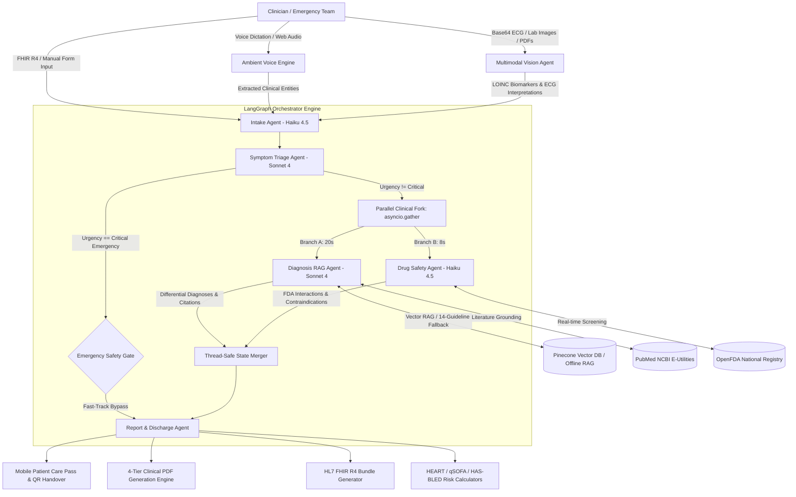

# MediGuard V2 🏥 — Enterprise Clinical Decision Support System (CDSS)

[](https://www.python.org/)
[](https://fastapi.tiangolo.com/)
[](https://github.com/langchain-ai/langgraph)
[](https://nextjs.org/)
[](https://aws.amazon.com/bedrock/)
[](https://www.pinecone.io/)
[](https://supabase.com/)
[](#-testing--quality-assurance)
[](https://opensource.org/licenses/MIT)
[](#)

---

## 🌐 Live Deployments & Portal Access

| Platform | Interface | Live URL | Access Mode |
| :--- | :--- | :--- | :--- |
| **🖥️ Clinical Command Center** | Attending Clinician Portal | [mediguard-v2.vercel.app](https://mediguard-v2.vercel.app) | Secure 3-Factor Auth / 1-Click Guest Access |
| **🎮 Zero-Auth Public Demo** | Emergency Simulation Hub | [mediguard-v2.vercel.app/demo](https://mediguard-v2.vercel.app/demo) | Instant 1-Click Clinical Pre-sets |
| **⚙️ OpenAPI Interactive Engine** | Swagger / OpenAPI Explorer | [mediguard-v2-1.onrender.com/docs](https://mediguard-v2-1.onrender.com/docs) | Public REST & WebSocket Endpoints |
| **📖 Technical Showcase** | Architecture & Case Studies | [mediguard-v2.vercel.app/showcase](https://mediguard-v2.vercel.app/showcase) | Deep Dive & Portfolio Review |

---

## 🎯 Executive Overview

**MediGuard V2** is an enterprise-grade, multi-agent **Clinical Decision Support System (CDSS)** engineered to assist emergency physicians and clinical teams during high-acuity patient intake, triage, and differential diagnosis. 

By orchestrating collaborative, autonomous reasoning agents inside a directed state graph (**LangGraph**), MediGuard V2 synthesizes unstructured clinical dictation, multimodal diagnostic attachments (laboratory biomarker panels and 12-lead ECG strips), and electronic health record (EHR) data. Findings are cross-referenced in real time against peer-reviewed **PubMed literature** (via Vector RAG) and **OpenFDA** pharmacovigilance databases. In **under 45 seconds**, the system produces validated differential diagnoses, critical drug interaction warnings, bedside clinical risk scores, exportable **HL7 FHIR R4** bundles, and **four distinct hospital-ready PDF document suites**.

---

## 🚀 Major System Upgrades & Architecture Enhancements

MediGuard V2 has been upgraded to a cutting-edge clinical intelligence architecture. Below is a comprehensive breakdown of all new features, functions, and architectural advancements implemented in this release:



---

### 1. 🔬 Multimodal Clinical Vision & Diagnostic Ingestion
* **15 Standard LOINC Ontology Analytes**: Automated extraction and mapping of laboratory biomarkers to universal LOINC standards with reference-range validation:
  * *Cardiac & Vascular*: Troponin I (`10839-9`), Troponin T (`6598-7`), BNP (`30934-4`), D-Dimer (`48065-7`).
  * *Metabolic & Renal*: Potassium (`2823-3`), Sodium (`2951-2`), Glucose (`2345-7`), Arterial Blood pH (`2744-1`), Bicarbonate/CO2 (`2028-9`), Creatinine (`2160-0`), BUN (`3094-0`), Lactate (`2524-7`).
  * *Hematology*: Hemoglobin (`718-7`), Platelets (`777-3`), White Blood Cell Count (`6690-2`).
* **Joint Commission & CAP Critical Panic Value Triggers**: Real-time safety threshold evaluations (e.g., Troponin I > 0.40 ng/mL, Lactate > 4.0 mmol/L, Potassium < 2.8 or > 6.0 mEq/L, Blood pH < 7.20). Exceeding panic thresholds triggers instant visual alerts and elevates pipeline triage priority.
* **12-Lead ECG Ischemic Telemetry & STEMI Detection**: Automated rhythm interpretation, QTc interval calculation, ST-elevation measurement, lead localization (`V1-V4`, `I`, `aVL`, `II`, `III`, `aVF`), and immediate catheterization lab activation flags.
* **Dual-Engine Extraction Architecture**: Employs live Multimodal Vision LLM parsing with automatic fallback to high-precision deterministic regex parsing for offline reliability.
* **1-Click Clinical Multimodal Presets**: Pre-configured emergency telemetry profiles (*Acute Anterolateral STEMI*, *Severe Diabetic Ketoacidosis with Profound Acidemia*, *Septic Shock with Severe Lactic Acidosis*) for frictionless clinical validation.

---

### 2. ⚡ Parallel Multi-Agent Execution (LangGraph Concurrency)
* **35–40% Pipeline Latency Reduction**: Upgraded the core LangGraph state graph to concurrently execute the **Diagnosis Agent** (PubMed Vector RAG + Differential Diagnosis) and **Drug Safety Agent** (OpenFDA drug-drug and allergy screening) via `asyncio.gather`.
* **Thread-Safe State Merging**: Implemented immutable state cloning prior to fork dispatch, followed by clean state reconciliation that merges differential diagnoses, drug interactions, contraindications, and error registries without race conditions.
* **Conditional Emergency Fast-Track Safety Gate**: When the Symptom Agent flags immediate life-threatening conditions (e.g., active stroke, impending airway compromise), the pipeline automatically bypasses non-essential differential steps and fast-tracks directly to emergency physician reporting.

---

### 3. 📚 14-Guideline Resilient Offline RAG Knowledge Base
* **Expanded Emergency Protocol Library**: Augmented the local clinical fallback knowledge base from 4 to 14 comprehensive, evidence-based emergency clinical practice guidelines covering:
  1. *Acute Coronary Syndrome (STEMI / NSTEMI)*
  2. *Severe Sepsis & Septic Shock (Surviving Sepsis Campaign)*
  3. *Acute Ischemic Stroke (AHA/ASA Guidelines)*
  4. *Diabetic Ketoacidosis & Hyperosmolar Hyperglycemic State*
  5. *Acute Pulmonary Embolism (PESI Score Management)*
  6. *Severe Anaphylaxis & Airway Compromise*
  7. *Hypertensive Emergency with Target Organ Damage*
  8. *Status Epilepticus & Prolonged Seizures*
  9. *Acute Decompensated Heart Failure (ADHF)*
  10. *Community-Acquired Pneumonia (CURB-65 Protocol)*
  11. *Acute Bacterial Meningitis*
  12. *Upper Gastrointestinal Hemorrhage & Variceal Bleeding*
  13. *Acute Asthma Exacerbation*
  14. *Acute Opioid Overdose & Naloxone Administration Protocol*
* **Network-Resilient Hybrid Retrieval**: If external Pinecone index queries experience network timeouts, DNS failure, or quota exhaustion, the retrieval engine seamlessly switches to local vector chunks without interrupting the physician's workflow.
* **Verified Evidence Grounding**: Every diagnostic suggestion is mapped to verified PubMed IDs (PMIDs), digital object identifiers (DOIs), source journals, publication years, and clinical takeaway badges.

---

### 4. 🧮 Interactive Bedside Clinical Risk Calculators
Integrated directly into the clinical report viewer (`/report/[sessionId]`), allowing attending clinicians to interactively adjust physiological parameters and view instant clinical risk stratifications:
* **HEART Score (Chest Pain Risk)**: Calculates 6-week risk of Major Adverse Cardiac Events (MACE). Evaluates History, ECG, Age, Risk Factors, and Initial Troponin. Categorizes patients into Low Risk (0–3), Moderate Risk (4–6), or High Risk (7–10) with management recommendations.
* **qSOFA Score (Sepsis Mortality)**: Evaluates bedside sepsis criteria (Respiratory Rate ≥ 22/min, Altered Mentation GCS < 15, Systolic BP ≤ 100 mmHg) with sepsis mortality alerts.
* **HAS-BLED Score (Bleeding Risk on Anticoagulation)**: Assesses 1-year risk of major bleeding in patients with atrial fibrillation or deep vein thrombosis (Hypertension, Abnormal Renal/Liver Function, Stroke, Bleeding history, Labile INR, Elderly > 65, Drugs/Alcohol).
* **Automated Parameter Pre-population**: Patient vitals and laboratory analytes extracted during intake automatically seed calculator fields to eliminate manual data entry.

---

### 5. 🎙️ Ambient Voice Intake & 32-Band Audio Spectrum Visualizer
* **Real-Time 32-Band Web Audio Visualizer**: Integrated frequency spectrum analyser providing live harmonic feedback during clinician voice dictation.
* **Dual-Tier Clinical Entity Extraction**: Combines backend LLM natural language processing (extracting chief complaint, onset timeline, vitals, current medications, and past medical history) with immediate client-side regex parsing fallback.
* **Form-Level Visual Auto-Population**: Highlights form fields populated from voice dictation with subtle pulse animations and `✨ Voice Extracted` badges.
* **1-Click Audio Scenario Presets**: Immediate test scenarios (e.g., *Elderly STEMI Presentation*, *Septic Nursing Home Resident*, *Polypharmacy Drug Confusion*) enable rapid evaluation without requiring microphone hardware.

---

### 6. 📡 Real-Time Multi-Agent Telemetry & Interactive Simulation Replay
* **Live Directed State Graph**: Visual topology displaying real-time execution status across all specialist agents with pulse animations and latency counters (`/patient/[sessionId]`).
* **Agent Inspector Modal**: Inspect exact raw prompt templates, model configurations, full context payloads, synthesized outputs, execution latencies, and token expenditures for every agent in the pipeline.
* **Interactive Simulation Replay Mode**: Step forward and backward through completed patient sessions with spatial Web Audio chime feedback on agent state transitions.
* **Live WebSocket Telemetry Console**: Streams chronological system logs, agent lifecycle events, and safety evaluations directly to the clinician interface.

---

### 7. 📄 Dual-Perspective Care & 4-Tier Clinical PDF Generation Engine
MediGuard V2 bridges the communication gap between clinicians and patients by compiling both technical clinical analyses and patient-friendly care plans:
* **Dual-Perspective Clinical Output**: Generates both formal medical differential diagnoses and a **Patient Discharge Care Plan** written at an accessible **6th-grade reading level**, explaining the condition, recovery steps, structured medication schedule, and red flag warnings.
* **Production-Grade PDF Suite (ReportLab)**: Generates 4 tailored document formats with custom styling, running headers, confidentiality footers, and background ECG watermarks:
  1. **Full Physician Clinical Decision Support Report**: In-depth report containing differential diagnosis rankings, confidence percentages, ICD-10 codes, OpenFDA interaction matrix, LOINC biomarkers, and PubMed citations.
  2. **Plain-Language Patient Health Summary**: Compassionate, jargon-free health summary covering home care instructions, dietary recommendations, and precautions.
  3. **Clinical Specialist Referral Letter**: Formal letter addressed to consulting specialists detailing the reason for referral, diagnostic workup, and attending clinician signature block.
  4. **Official Hospital Discharge Summary**: Structured discharge documentation with presenting complaints, discharge diagnoses, medication reconciliation, and follow-up timelines.

---

### 8. 📱 Mobile Patient Care Pass & Cryptographic QR Handover
* **Instant Smartphone Handover (`/discharge/[sessionId]`)**: Clinicians can generate a cryptographic QR code directly on their workstation screen, allowing patients and family members to scan and take their discharge instructions home on their smartphones.
* **Interactive Mobile Patient Pass**:
  * **One-Tap 911 Emergency Calling**: Instant access to emergency services if red-flag symptoms develop.
  * **Interactive Medication Schedule**: Tap-to-complete daily medication checkboxes that track doses and display administration instructions.
  * **Plain-Language Diagnosis Explanations**: Clear explanations of what occurred during the hospital visit.
  * **Critical Emergency Red Flags**: Highlighted warning signs (e.g., chest pain lasting > 5 min, facial droop, sudden shortness of breath) indicating need for immediate ER return.
  * **One-Tap Caregiver Dispatch**: Share the discharge pass with family or home caregivers via WhatsApp or secure email.

---

### 9. 🔐 Enterprise Security, 3-Factor Authentication & Reorganized Analytics
* **3-Factor Authentication Hierarchy**: Access gated by JWT Bearer tokens, unique hospital institution codes (`INST-XXXX`), and role-scoped clinician credentials.
* **1-Click Guest Clinician Access**: Frictionless reviewer credentials permitting instant evaluation of authenticated routes without cold-start delays or authentication loops.
* **Self-Service Credential Management**: Clinicians can securely rotate key phrases and update account passwords via `/account/change-key-phrase`.
* **PostgreSQL Row Level Security (RLS)**: Enforces strict tenant data isolation at the database layer; users cannot query session records belonging to another institution.
* **Reorganized Clinical Command Center (`/dashboard`)**: Redesigned layout featuring 8 interactive visualizations:
  * *Agent Execution Latencies* (bar chart)
  * *Daily Patient Intake Trends* (area chart)
  * *Patient Age & Gender Demographics* (distribution chart)
  * *Top Clinical Diagnosis Patterns* (radar / bar chart)
  * *Drug Interaction Frequency by Severity* (donut chart)
  * *Triage Urgency Distribution* (severity breakdown)
  * *Recent Patient Sessions Queue* with instant search and status filtering.

---

### 10. 🛡️ DeepEval Automated Safety Gating & Defensive Normalization
* **Automated CI/CD Clinical Evaluation**: Integrated test suite evaluating 20 comprehensive clinical cases across 6 clinical reasoning metrics (medical accuracy, clinical safety, hallucination avoidance, triage precision, drug safety recall, and diagnostic completeness).
* **3 Automated Deployment Gates**: Every release must satisfy:
  * Minimum **85%** overall clinical pass rate.
  * Minimum **95%** clinical safety score.
  * Maximum **10%** hallucination ceiling.
* **140 Passing Tests**: Rigorous unit, integration, and security test suite passing with 100% success rate.
* **Defensive Output Sanitization**: Report Agent employs multi-pass JSON parsing capable of stripping markdown code blocks, prose wrappers, single-element array anomalies, and malformed LLM responses to prevent pipeline crashes.

---

## 🤖 The 5-Agent Specialist Pipeline

| Agent | Core LLM Model | Primary Clinical Responsibility | Execution Latency |
| :--- | :--- | :--- | :--- |
| **1. Intake Agent** | Claude Haiku 4.5 | Parses voice dictation, clinical notes, and multimodal lab/ECG inputs into clean clinical JSON schemas | ~8 seconds |
| **2. Symptom Agent** | Claude Sonnet 4 | Evaluates symptom severity (0–10), maps anatomical ICD-10 codes, and guards the Emergency Safety Gate | ~12 seconds |
| **3. Diagnosis Agent** | Claude Sonnet 4 (Reasoning) | Computes ranked differential diagnoses grounded in vector-retrieved PubMed articles and clinical guidelines | ~20 seconds *(Parallel)* |
| **4. Drug Check Agent** | Claude Haiku 4.5 | Screens active medications and new treatments against OpenFDA records for drug-drug interactions & allergies | ~8 seconds *(Parallel)* |
| **5. Report Agent** | Claude Sonnet 4 | Synthesizes clinician findings, 6th-grade patient discharge plans, HL7 FHIR R4 bundles, and 4 PDF document types | ~15 seconds |

> **Multi-Provider LLM Fallback Routing**: AWS Bedrock is configured as the primary provider (Claude Haiku 4.5 and Sonnet 4). Google Gemini and Groq are supported as drop-in alternatives via the `LLM_PROVIDER` environment variable with automated fallback tiers (*fast*, *balanced*, and *reasoning*).

---

## 🏗️ Technical Architecture & Stack

| Layer | Technologies & Frameworks | Details & Purpose |
| :--- | :--- | :--- |
| **AI Orchestration** | LangGraph, LangChain, AWS Bedrock | Parallel StateGraph, conditional safety edges, supervisor routing |
| **Foundation Models** | Claude 3.5 Sonnet / Claude Haiku 4.5 | Multi-tiered reasoning (Fast, Balanced, Deep Reasoning) |
| **Vector DB & RAG** | Pinecone, OpenAI / Bedrock Embeddings | Semantic literature search against 500+ indexed PubMed clinical articles |
| **Backend API** | Python 3.11, FastAPI, Uvicorn, WebSockets | Asynchronous event streaming, REST endpoints, Docker containerization |
| **Relational Database**| PostgreSQL (Supabase), Row Level Security (RLS) | Multi-tenant hospital isolation, session states, immutable audit logs |
| **Frontend Portal** | Next.js 14 (App Router), TypeScript, React 18 | Server-Side Rendering (SSR), Tailwind CSS, Framer Motion, Zustand |
| **Visualization & Audio**| Web Audio API, Recharts, Lucide React | 32-band spectrum analyser, real-time agent graphs, interactive analytics |
| **Document Generation**| ReportLab 4.x, QRCode, Canvas API | Production PDF generation with ECG watermarks, QR pass generator |
| **Health Standards** | HL7 FHIR R4, LOINC, ICD-10-CM, OpenFDA | Interoperability standards for EHR export and pharmacovigilance |
| **Evaluation & QA** | DeepEval, Pytest, Ruff | Automated clinical benchmarking, 6 evaluation metrics, 3 deploy gates |

---

## 📡 API Reference & Key Endpoints

| Method | Endpoint | Description |
| :--- | :--- | :--- |
| `POST` | `/api/v1/auth/login` | Clinician login verifying JWT token, staff ID, and hospital institution code |
| `POST` | `/api/v1/auth/guest-login` | 1-Click guest clinician access for portfolio and peer-review evaluation |
| `POST` | `/api/v1/auth/change-key-phrase` | Self-service password and key phrase rotation |
| `POST` | `/api/v1/patient/intake` | Initializes a patient session and dispatches the LangGraph reasoning pipeline |
| `GET` | `/api/v1/patient/{sessionId}` | Retrieves current session state, vitals, symptoms, and progress |
| `POST` | `/api/v1/multimodal/analyze` | Ingests base64 clinical images/PDFs and extracts LOINC biomarkers and ECG data |
| `GET` | `/api/v1/multimodal/presets` | Returns pre-configured clinical emergency scenarios (STEMI, DKA, Sepsis) |
| `POST` | `/api/v1/voice/parse` | Natural language clinical entity extraction from dictation audio or transcripts |
| `GET` | `/api/v1/report/{sessionId}` | Fetches clinical summary, differential diagnosis, and patient discharge plan |
| `GET` | `/api/v1/report/{sessionId}/pdf` | Generates on-demand clinical PDF (`type=clinical`, `patient`, `referral`, `discharge`) |
| `GET` | `/api/v1/report/{sessionId}/fhir` | Exports full HL7 FHIR R4 bundle (`Patient`, `Condition`, `CarePlan`, `DiagnosticReport`) |
| `GET` | `/api/v1/analytics/dashboard` | Compiles multi-tenant hospital performance, latency, and diagnostic analytics |
| `WS` | `/ws/patient/{sessionId}` | Real-time bi-directional WebSocket telemetry streaming agent events and tokens |

---

## 💻 Local Setup & Development

### 1. Prerequisites
* **Python**: 3.11+
* **Node.js**: 18+ (with `npm` or `pnpm`)
* **Vector DB**: Pinecone API key
* **Relational DB**: Supabase PostgreSQL database
* **LLM Provider**: AWS Bedrock credentials (or Gemini / Groq API key)

### 2. Clone Repository
```bash
git clone https://github.com/Adithya0805/mediguard-v2.git
cd mediguard-v2
```

### 3. Backend Setup
```bash
cd backend
python -m venv .venv

# On Linux/macOS:
source .venv/bin/activate
# On Windows:
.venv\Scripts\activate

pip install -r requirements.txt
pip install -r requirements-dev.txt
```

### 4. Frontend Setup
```bash
cd ../frontend
npm install
```

### 5. Environment Configuration
Create a `.env` file in `backend/` with the following variables:
```env
# Application & Authentication
SECRET_KEY=your_secure_jwt_secret_key_minimum_32_chars
ENVIRONMENT=development

# Database (Supabase PostgreSQL)
SUPABASE_URL=https://your-project.supabase.co
SUPABASE_KEY=your_supabase_anon_or_service_key

# Vector Database (Pinecone)
PINECONE_API_KEY=your_pinecone_api_key
PINECONE_INDEX_NAME=mediguard-pubmed

# LLM Routing — "bedrock" (default), "gemini", or "groq"
LLM_PROVIDER=bedrock
AWS_ACCESS_KEY_ID=your_aws_access_key
AWS_SECRET_ACCESS_KEY=your_aws_secret_key
AWS_REGION=us-east-1

# Optional Alternates
# GEMINI_API_KEY=your_gemini_api_key
# GROQ_API_KEY=your_groq_api_key
```

In `frontend/`, configure `.env.local`:
```env
NEXT_PUBLIC_API_URL=http://localhost:8000
NEXT_PUBLIC_WS_URL=ws://localhost:8000
```

### 6. Running the Application Locally
**Start Backend Engine:**
```bash
cd backend
.venv\Scripts\activate  # Windows (.venv/bin/activate on Linux/Mac)
uvicorn app.main:app --reload --port 8000
```

**Start Frontend Portal:**
```bash
cd frontend
npm run dev
```
Open [http://localhost:3000](http://localhost:3000) in your web browser.

---

## 🧪 Testing & Quality Assurance

MediGuard V2 enforces strict quality standards across all modules.

```bash
cd backend
.venv\Scripts\activate

# 1. Execute Full Pytest Suite (140 tests)
pytest -q

# 2. Run Ruff Linting & Formatting Checks
ruff check app/ tests/

# 3. Execute DeepEval Clinical Safety Gating (Offline Mock Mode)
python evals/run_eval.py --use-mock

# 4. Execute Frontend Type-Checking & Linting
cd ../frontend
npm run lint
```

---

## 🎮 Zero-Auth Public Demo Mode

No registration or credential setup is required to evaluate the clinical pipeline:
1. Navigate to [mediguard-v2.vercel.app/demo](https://mediguard-v2.vercel.app/demo).
2. Choose from pre-configured emergency scenarios:
   * **Acute Coronary Syndrome (62M)** — Retrosternal chest pressure, troponin elevation, ST changes.
   * **Severe Sepsis Alert (71F)** — High fever, altered mental status, hypotension, lactic acidosis.
   * **Acute Ischemic Stroke (58F)** — Sudden unilateral hemiparesis and facial asymmetry.
   * **Polypharmacy Adverse Interaction (78M)** — Severe warfarin-amiodarone bleeding conflict.
   * **Severe Diabetic Ketoacidosis (24F)** — Profound acidemia, blood glucose > 490 mg/dL.
3. Observe live agent execution, telemetry streaming, PubMed citation grounding, and instant PDF compilation.

---

## 👨‍💻 Engineering & Contact

* **Lead AI Engineer**: Adithya Kuppusamy
* **Specialization**: Applied AI, Healthcare Informatics & Multi-Agent Distributed Systems
* **Location**: Tamil Nadu, India
* **Portfolio**: [adithyaai.is-cool.dev](https://adithya-ai-hub.vercel.app/)
* **Connect**: [LinkedIn Profile](https://www.linkedin.com/in/adithya-kuppusamy-854746270) | [GitHub](https://github.com/Adithya0805)

---

## ⚠️ Clinical Disclaimer & Regulatory Notice

> **IMPORTANT CLINICAL NOTICE:**  
> MediGuard V2 is an artificial intelligence-assisted clinical decision support system designed exclusively for educational, technical portfolio, and research evaluation purposes. It is **not** a certified medical diagnostic device and does not replace the expert clinical judgment of a licensed healthcare provider. All diagnostic suggestions, risk scores, drug interaction alerts, and care instructions must be reviewed and confirmed by a certified clinician prior to any medical intervention or change in patient management.
